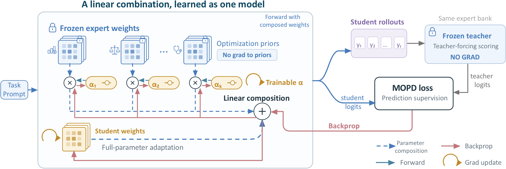
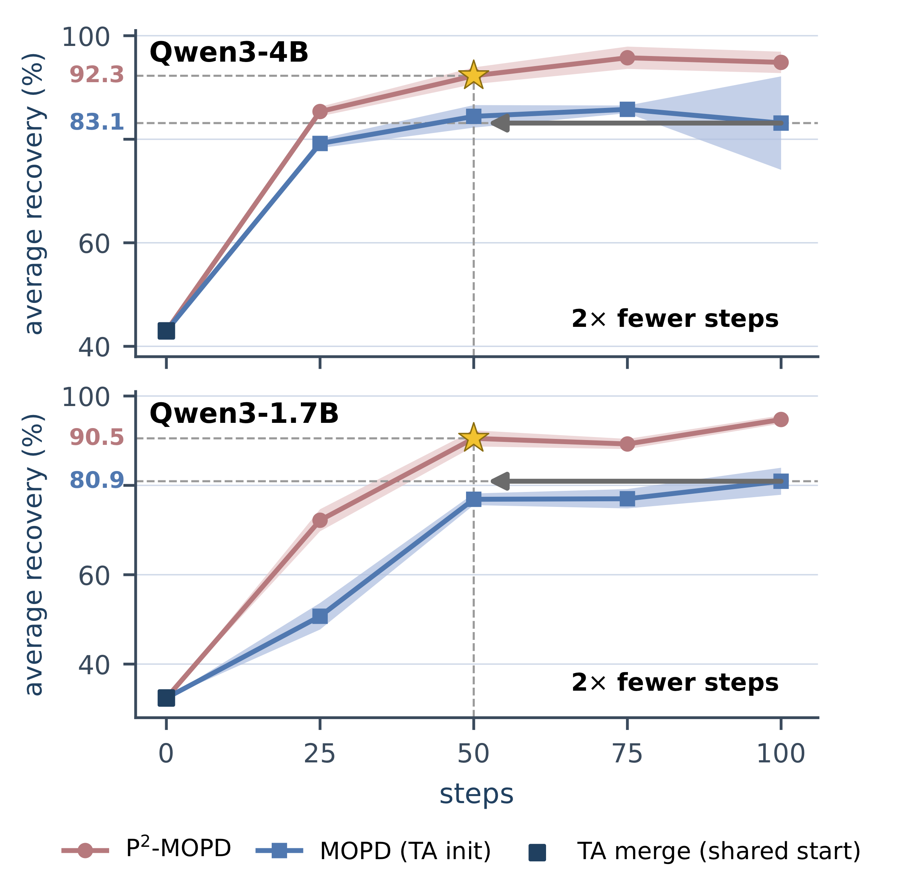

<div align="center">

# P²-MOPD: Accelerating Multi-Teacher On-Policy Distillation via Parameter Priors

Sinuo Wang, Jiacheng Lu, Zeyu Zhang, Maojia Song, Rui Sun, Beidi Luan, Yutong Xie, Jing Li, Daxin Jiang, Qi Wu, Zuo Bai

[](https://arxiv.org/abs/2611.03953)

</div>

This repository hosts the official implementation of [P²-MOPD](https://arxiv.org/abs/2611.03953).

## Overview

Multi-teacher on-policy distillation (MOPD) consolidates domain experts into one student by letting each teacher supervise the student's own responses. Task arithmetic offers a training-free alternative, adding a weighted sum of the experts' task vectors to the base model.

**P²-MOPD treats the linear combination of student and expert parameters as a single differentiable model.** Every linear projection of the student is composed as

$$W_m = B_m + \sum_{k=1}^{K} \alpha_{k,m}\,\tau_{k,m},$$

where $\tau_{k,m}$ is the frozen task vector of expert $k$, $B_m$ are trainable student weights and $\alpha_{k,m}$ are learnable mixing coefficients. Both are optimized jointly under the standard MOPD objective. The experts therefore guide the student in two ways: their logits supervise its outputs, and their weights act as **parameter priors** that the student can move along through one scalar per module. Because the student weights stay trainable, the model is not confined to the span of the task vectors.

<p align="center">
  
</p>

After training, $\alpha$ is folded into the weights, so the output is a standard checkpoint and inference cost is unchanged.

## Highlights

- **Faster.** P²-MOPD surpasses the final average recovery of MOPD from the same task-arithmetic start after half the training steps, at both 1.7B and 4B.
- **More balanced.** Worst-domain recovery rises from 47.2% / 32.0% to 89.4% / 88.0% (4B / 1.7B), and the across-domain std of recovery falls from 21.8 / 28.4 to 4.6 / 4.8.
- **Interpretable.** The learned mixing coefficients consistently identify the teacher the student most needs (the medical coefficient rises from 0.25 to 0.63 / 0.65), without any validation data.
- **Cheap at inference.** The released model is a plain checkpoint; training adds only about $10^3$ coefficients.

<p align="center">
  
</p>

## Main results

Four domains (MedQA, CaseHOLD, FinQA, IFBench), Qwen3-4B and Qwen3-1.7B students, 100 training steps. Recovery is $(s - s_{\text{base}})/(s_{\text{teacher}} - s_{\text{base}})$ per domain; scores are avg@3. P²-MOPD, MOPD (TA init) and IM-MOPD are three-seed means.

| Method | 4B Avg. Recovery | 4B Worst | 1.7B Avg. Recovery | 1.7B Worst |
|---|---:|---:|---:|---:|
| TA merge (untrained) | 42.98 | 23.67 | 32.41 | 17.15 |
| MOPD | 46.80 | -53.94 | -15.74 | -261.18 |
| MOPD (SFT warm-up) | 66.15 | 8.32 | 37.13 | -38.72 |
| MOPD (TA init) | 83.13 | 47.22 | 80.93 | 32.03 |
| Open-MOPD | 84.20 | 56.55 | 79.79 | 44.99 |
| IM-MOPD | 88.02 | 84.12 | 67.81 | 48.73 |
| **P²-MOPD (ours)** | **94.85** | **89.42** | **94.74** | **88.01** |

Full per-domain scores, ablations and analyses are in the paper.

## Roadmap

- [ ] P²-MOPD training (module, layer and model coefficient granularity)
- [ ] MOPD baselines from the same task-arithmetic start
- [ ] Evaluation scripts for MedQA, CaseHOLD, FinQA and IFBench
- [ ] Analysis scripts (task-vector projection, learned coefficients)
- [ ] Trained checkpoints

## Citation

If you find this work useful, please cite:

```bibtex
@article{wang2026p2mopd,
  title   = {P$^2$-MOPD: Accelerating Multi-Teacher On-Policy Distillation via Parameter Priors},
  author  = {Wang, Sinuo and Lu, Jiacheng and Zhang, Zeyu and Song, Maojia and Sun, Rui and Luan, Beidi and Xie, Yutong and Li, Jing and Jiang, Daxin and Wu, Qi and Bai, Zuo},
  journal = {arXiv preprint arXiv:2611.03953},
  year    = {2026}
}
```

## Contact

For questions, please open an issue in this repository.
